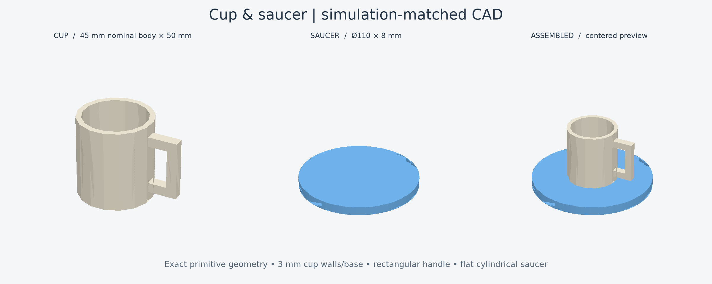

# Cup and saucer CAD

Simulation-matched CAD exported November 16, 2026. Dimensions come from the
checked-in `baseline_v1` task profile and its world generator. The remote host
was unreachable during this export; no claim is made about uncommitted remote
geometry changes. The legacy `cup_arrangement` profile has a different cup
radius and is deliberately not used.



## Downloads

- [Cup STEP](cup.step)
- [Saucer STEP](saucer.step)
- [Cup on saucer assembly STEP](cup_on_saucer.step)
- [Render PNG](preview.png)
- [Validation and source hashes](validation.json)

All STEP files use **millimetres**, Z up. Individual parts have their underside
at Z=0, with the cup body / saucer centered on X=Y=0. The cup handle faces +X.
The assembly places the cup underside at Z=8 on the saucer; this is an illustrative
centered placement, not the randomized starting scene.

| Feature | Simulation dimensions converted to mm |
|---|---|
| Cup nominal body diameter | 45 |
| Cup overall height | 50 |
| Cup walls / bottom thickness | 3 / 3 |
| Cup wall construction | 16 overlapping rectangular wall segments |
| Handle horizontal bars | 18 × 6 × 6 each |
| Handle outer vertical bar | 6 × 6 × 36 |
| Saucer diameter / thickness | 110 / 8 |

The cup is intentionally faceted. Its wall-box corners slightly exceed the
nominal circular diameter; see measured bounding dimensions in `validation.json`.
The handle is rectangular and the saucer is a flat cylinder without a rim or
recess, exactly as modeled in the simulator. No smoothing, fillets, manufacturing
tolerances or ceramic design assumptions were added. These are simulation
geometry exports, not manufacturing-qualified drawings.

The cup's overlapping simulation primitives are fused into one valid CAD solid;
the saucer is a second valid solid. The original physical mass/friction and
collision settings remain in the simulator and are not conveyed by STEP.

## Regenerate / edit

The Python source is the editable parametric model; STEP provides transferable
solid geometry but does not preserve a native SolidWorks/FreeCAD feature tree.
The cup generator calls the actual simulation geometry function, then converts
its visual boxes/cylinder to CAD solids. Profile metres are converted to mm.

From the repository root, in a separate Python 3.12 environment:

```bash
python3.12 -m venv /tmp/cup-cad-env
/tmp/cup-cad-env/bin/pip install -r cad/cup_saucer/requirements.txt
MPLCONFIGDIR=/tmp/cup-cad-mpl /tmp/cup-cad-env/bin/python cad/cup_saucer/generate.py
```

This rewrites the exports, preview and validation report. It does not start or
modify a simulation. The script verifies solid validity, STEP reimport volume
and bounding dimensions, and the assembly's two-solid count. The preview is
rendered from the reimported STEP geometry. See the
[CadQuery STEP documentation](https://cadquery.readthedocs.io/en/latest/importexport.html).
